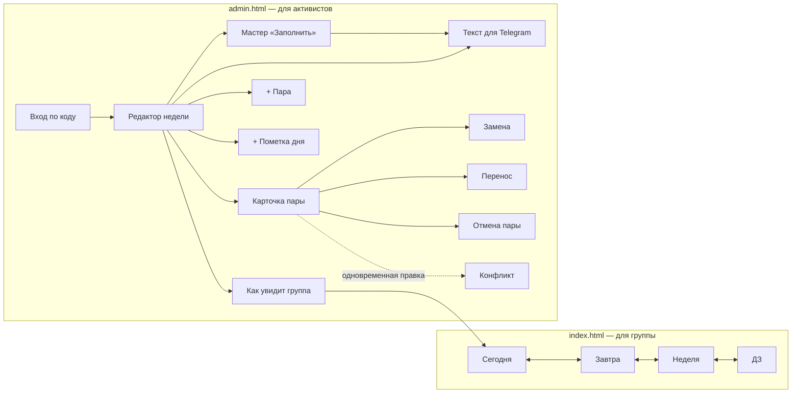

# Дизайн: Расписание группы 322

Источник требований: `BRIEF.md`, `PLAN.md`, `ACTIVIST_UX.md`. Этот файл — всё, что нужно для сборки интерфейса.

## Концепция: «журнал группы»
Оформление взято из мира, в котором живёт группа: разлинованная бумага официального расписания, чернила и штампы.
- **Фон** — бумага с едва заметной сеткой 24 px (как клетки расписания); карточки дней — белые листы.
- **Предмет = цветная плитка с сокращением** (МУН, ГПП, УПП, УП, ГП, ТП, ОСД, МП, ФК). Ищешь глазами по цвету, не читая. Цвет никогда не единственный носитель смысла: на плитке всегда текст.
- **Статусы переносов и отмен — штампы**: косая рамка «ПЕРЕНЕСЕНО → 07.11» (чернильно-синяя) и «ОТМЕНЕНО» (красная). Штамп продублирован текстом в `aria-label` строки.
- **Верхняя/нижняя неделя — значок половинки клетки** (закрашена верхняя или нижняя половина квадрата) + подпись словами.
- **Шрифты:** Unbounded — дни, заголовки, плитки; Onest — весь текст интерфейса; JetBrains Mono — время, аудитории, ссылки (цифры ровно в столбик). Все три — с кириллицей, лицензия SIL OFL 1.1, файлы лежат в проекте (`site/fonts/`), без внешних запросов.
- **Акцент** — чернильный синий; главные действия — тёмные «чернильные» плашки (карточка «Заполнить», «Идёт сейчас»).
- Эталон внешнего вида — `prototype/raspisanie-322.html`.

## Карта экранов



Панели (карточка пары, замена, перенос, отмена, «+ пара», пометка, Telegram) — **нижние листы**: выезжают снизу, занимают до 90 % высоты, закрываются крестиком, свайпом вниз, Esc и нажатием на затемнение. Конфликт — диалог по центру.

---

## Экраны для группы (`index.html`)

### 1. Сегодня / Завтра
**Назначение:** за одну секунду понять, где и что за пары, что готовить.
**Элементы:**
- Шапка: «Вторник, 27 октября» · «верхняя неделя»; переключатель вкладок `Сегодня | Завтра | Неделя` (вкладка выбрана автоматически: после 18:30 — «Завтра», в воскресенье — понедельник).
- Плашка «Сейчас: УПП, ауд. 115 · до 14:50» или «Следующая: ГПП, ауд. 219 · через 25 мин» (только в учебный день).
- Пометки дня — строкой под шапкой («Сменка»).
- Карточки пар по времени: номер (1⃣), время (`15:00–16:30`, моноширинные цифры), аудитория крупно, предмет + тип, ДЗ (подпись + ссылки), постоянная пометка шаблона, метка «изменено вчера, 21:24» (48 ч).
- Текущая пара подсвечена фоном `--now`.
- Отменённая: зачёркнута, «Отменена: <причина>». Перенесённая: зачёркнута, «Перенесена на 5 ноября, 18:30, ауд. 219» (ссылка на тот день). Перенесённая сюда: значок ⇄ и «перенос с 3 ноября». Доп. пара: «доп. пара».
**Состояния:**
- *Загрузка:* сразу показывается сохранённое; если сохранённого нет — 3 серых заглушки карточек (без «прыжков»: та же высота).
- *Нормальное:* как выше.
- *Пусто (пар нет):* «Сегодня пар нет» + «Ближайшие: четверг, 9:40 — МП, ауд. 312» + кнопка «Показать четверг».
- *Без сети:* плашка сверху «Нет сети. Показано сохранённое от 31 октября, 21:40».
- *Ошибка (нет сети и нет сохранённого / сервер не ответил):* «Не удалось загрузить расписание. Проверьте интернет и нажмите „Повторить“.» + кнопка «Повторить».
- *Вне семестра:* «Семестр закончился 31 декабря. Новое расписание появится, когда его внесут.»

### 2. Неделя
**Назначение:** посмотреть всю неделю и соседние.
**Элементы:** «‹ 26 окт – 31 окт · верхняя ›», дни списком (заголовок дня + компактные строки пар: номер, время, аудитория, предмет, значок ДЗ), нажатие на строку раскрывает ДЗ; кнопка «Эта неделя», если листнули далеко.
**Состояния:** загрузка/без сети/ошибка — как выше; *пусто (неделя без пар, каникулы)* — «На этой неделе пар нет» + «Следующая неделя ›».

### 2а. ДЗ — «Что готовить»
**Назначение:** одним списком увидеть, что сдавать в ближайшие дни.
**Элементы:** заголовок «Что готовить»; группы «К четвергу, 5 ноября»; в группе — плитка предмета, «Трудовое право · 16:50», подпись ДЗ, ссылки (моноширинные, сокращённые). Берутся дни от сегодня до конца следующей недели; пары с отметкой «ДЗ нет» не показываются.
**Состояния:** *пусто* — «ДЗ пока не вписано. Активисты обычно заполняют неделю на выходных»; загрузка/без сети/ошибка — как у «Сегодня».

---

## Экраны для активистов (`admin.html`)

### 3. Вход
**Назначение:** пустить активиста одним кодом.
**Элементы:** заголовок «Для активистов»; поле «Код доступа» (`type="text" inputmode="numeric" autocomplete="one-time-code"`, подпись над полем, пример «например, 123456» в плейсхолдере); флажок «Запомнить на этом телефоне» (включён); кнопка «Войти»; мелко: «Нет кода? Напишите Еремею».
**Состояния:** обычное; *загрузка* — кнопка «Проверяю…» той же ширины, отключена; *ошибка* — под полем «Код не подошёл. Проверьте цифры» (`aria-invalid`, фокус в поле); *блокировка* — «Слишком много попыток. Попробуйте через 10 минут или напишите Еремею», кнопка отключена с объяснением; *нет сети* — «Нет сети — вход невозможен. Подключитесь к интернету».
**Пусто:** не применяется (форма).

### 4. Редактор недели
**Назначение:** за 5 минут заполнить неделю, за 15 секунд — внести срочную замену.
**Элементы:**
- Шапка: «‹ 2–7 ноября · нижняя ›», имя активиста и меню (Выйти, Подсказки).
- Прогресс: «ДЗ: 4 из 7 семинаров» — тонкая полоса + текст.
- Дни списком; в заголовке дня кнопки «+ пометка», «+ пара»; пометки дня — чипами.
- Строки пар (вся строка — зона нажатия ≥ 48 px): номер, время, аудитория, предмет · тип, справа статус: «● ДЗ» / «○ нет ДЗ» (только семинары) и значки ⇄ ✎ ✕; у изменённых — «Активист 1, 21:24».
- Лекции свёрнуты в одну строку «2 лекции ▾», если в них нет ДЗ и изменений.
- Нижняя закреплённая панель: «Как увидит группа» · «Текст для Telegram» · индикатор сохранения.
**Индикатор сохранения:** «Сохранено ✓» (только после ответа сервера) / «Сохраняю…» / «Нет сети — 2 изменения отправлю позже» / «Не сохранилось. Повторить».
**Состояния:**
- *Загрузка:* заглушки строк; если неделя уже была загружена — показываем её сразу.
- *Пусто (в неделе нет пар):* «На этой неделе по шаблону пар нет» + кнопка «+ Добавить пару».
- *Ошибка загрузки:* «Не удалось загрузить неделю. Проверьте интернет» + «Повторить».
- *Без сети:* редактор работает, изменения копятся в очереди, плашка «Нет сети — изменения сохраняются на телефоне».
- *Код отозван:* «Ваш код больше не действует. Напишите Еремею» → возврат ко входу (очередь не теряется, её можно отправить после нового входа).

### 4а. Полоса дней (закреплена под шапкой редактора)
Шесть кнопок ПН–СБ: день, число (моноширинное), точка-статус: залитая зелёная — все семинары дня заполнены (с ДЗ или «ДЗ нет»), пустая — есть незаполненные, нет точки — семинаров нет. Сегодняшний день обведён. Нажатие прокручивает к дню. День без пар — кнопка недоступна. `aria-label` называет день и статус словами.

### 4б. Карточка «Заполнить ДЗ» (над днями)
Тёмная плашка: «ДЗ: 1 из 4 семинаров», подсказка «Пройдём по семинарам по очереди — около минуты», кнопка «Заполнить», полоска из сегментов (по одному на семинар). Когда всё заполнено — светлая плашка «Все семинары заполнены» и кнопка «Telegram».

### 4в. Мастер «Заполнить» (лист на всю высоту)
**Назначение:** самый быстрый путь: неделя за ~1 минуту.
**Элементы:** сегменты прогресса сверху; плитка + «Муниципальное право», «Семинар 1 из 4 · вт 3 ноября · 11:40 · ауд. 211»; блок «Прошлое занятие · вт 27 октября» с кнопкой **«Как в прошлый раз»**; частые фразы; поле «Подпись к ДЗ»; ссылки и «Вставить ссылку»; закреплённый низ: **«ДЗ нет»** (1/3 ширины) и **«Дальше ›»** (2/3, крупная). Под ними — «‹ Предыдущий семинар». Открывается на первом незаполненном семинаре.
**Финал:** галочка в круге, «С ДЗ: 3 · без ДЗ: 1 · пропущено: 0», кнопки «Текст для Telegram» и «Вернуться к неделе».
**Состояния:** «ДЗ нет» недоступна, если ДЗ уже вписано (подсказка «ДЗ уже вписано»); у отмеченного «ДЗ нет» — кнопка «Вернуть»; *пусто (семинаров на неделе нет)* — кнопка «Заполнить» не показывается, в плашке «На этой неделе семинаров нет».

### 5. Карточка пары (нижний лист)
**Назначение:** вписать ДЗ и открыть изменения пары.
**Элементы:**
- Заголовок: «ГПП · семинар», строка «вт 3 ноября · 15:00–16:30 · ауд. 219», постоянная пометка шаблона.
- Блок «ДЗ»: чипы частых фраз (до 6, горизонтальная прокрутка); поле «Подпись к ДЗ» (растягивается, счётчик «123 / 5000» появляется после 4000).
- Блок «Ссылки»: список ссылок (сокращённый вид `t.me/…/26/3137` + бейдж темы «ГПП ✓» или жёлтый «тема ОСД?» + кнопка «Удалить» с `aria-label`); кнопка «Вставить ссылку»; поле «или вставьте сюда» (долгое нажатие → Вставить).
- Кнопка «Как в прошлый раз (27 окт)» — показывает прошлое ДЗ в превью; подставляет одним нажатием.
- Блок «Изменения в этот день»: «Аудитория», «Время», «Преподаватель», «Перенести», «Отменить пару».
**Состояния:**
- *Пусто (ДЗ ещё нет):* поле пустое с подсказкой «Например: Доклады»; если было прошлое ДЗ — кнопка «Как в прошлый раз» выделена.
- *Прошлого ДЗ нет:* кнопки «Как в прошлый раз» нет (не показываем недоступное без смысла).
- *Предупреждение о теме:* жёлтая плашка «Ссылка из темы ОСД, а пара — ГПП. Всё верно?» [Оставить] [Удалить].
- *Неверная ссылка:* «Это не похоже на ссылку. Скопируйте ссылку на сообщение в Telegram и нажмите „Вставить ссылку“».
- *Буфер недоступен (iPhone отказал):* «Не получилось прочитать буфер. Вставьте ссылку в поле ниже долгим нажатием».
- *Сохранение:* автоматически; плашка «Сохранено · Отменить» (10 с) — только после ответа сервера; при офлайне — «Сохранено на телефоне · отправлю позже».

### 6. Замена (аудитория / время / преподаватель)
**Элементы:** поле с текущим значением (аудитория — `inputmode="text"`, время — выбор из сетки 8:00…20:10 + «Своё время» с двумя полями `ЧЧ:ММ`); переключатель «Только 3 ноября» (по умолчанию) / «С 3 ноября и дальше»; при «дальше» — необязательное «по дату»; кнопка «Сохранить замену»; если замена уже есть — «Убрать замену».
**Состояния:** *ошибка* — «Время окончания должно быть позже начала»; *предупреждение* — «В это время уже стоит УПП»; *подтверждение для „дальше“* — текст на кнопке «Заменить во всех следующих нижних неделях» (явно называет последствия, без лишнего диалога) + «Отменить» 10 с.

### 7. Перенос
**Элементы:** «Новая дата» (`type="date"`, недели в подсказке подписаны верх/низ), «Время» (сетка или своё), «Аудитория» (подставлена), блок **«Было → Стало»** (две мини-карточки), предупреждения, кнопка «Перенести».
**Состояния:** *ошибка* — «Выберите дату в пределах семестра (14.09–31.12.2026)»; *предупреждения* — «в это время уже стоит УПП», «это воскресенье»; *у перенесённой пары* — «Перенести ещё раз» и «Отменить перенос» (возвращает оба дня; «Отменить» 10 с).

### 8. Отмена пары
**Элементы:** «Причина (необязательно)» с примерами-чипами («Преподаватель заболел», «Перенос — дата позже»), кнопка «Отменить пару» (цвет `--stamp-cancel`); у отменённой — «Вернуть пару».
**Состояния:** после отмены — «Пара отменена · Вернуть» 10 с.

### 9. + Пара
**Элементы:** «Предмет» (список предметов шаблона + «Другое»), «Тип» (подставлен), «Дата» (подставлена — день, из которого открыли), «Время», «Аудитория» (подставлена обычная), «Преподаватель» (подставлен), кнопка «Добавить пару».
**Состояния:** *ошибка* — «Укажите название предмета»; предупреждение о пересечении; у доп. пары в карточке — «Удалить пару» (с «Отменить» 10 с).

### 10. + Пометка дня
**Элементы:** чипы («Сменка», «Полная посещаемость», «Сдаём …»), поле «Своя пометка» (до 200 знаков), кнопка «Добавить». У существующей — «Изменить» / «Удалить».
**Пусто:** не применяется (форма).

### 11. Текст для Telegram
**Элементы:** переключатель «По дням | Вся неделя | Изменения»; превью текста моноширинным блоком как в Telegram; «По дням» — кнопка «Скопировать понедельник», после копирования меняется на «Скопировать вторник» и т. д. (с отметкой ✓ у скопированных); «Вся неделя» — «Скопировать всё»; «Изменения» — список изменений за неделю с отдельной кнопкой копирования у каждого.
**Состояния:** *скопировано* — «Скопировано ✓» на кнопке на 2 с (это локальное действие, сервер не нужен); *копирование запрещено браузером* — текст выделяется целиком + «Нажмите „Копировать“ в меню»; *пусто (изменений нет)* — «На этой неделе изменений не было».

### 12. Как увидит группа
Открывает экран «Неделя» для этой недели в режиме предпросмотра (полоса «Предпросмотр — так видит группа · Вернуться к редактору»).

### 13. Конфликт (диалог)
**Элементы:** «Активист 1 изменил(а) эту пару 2 минуты назад»; две колонки «Её вариант» / «Ваш вариант»; кнопки «Оставить её», «Оставить мой», для ссылок — «Объединить ссылки».
**Ошибка:** если сохранить выбор не удалось — «Не сохранилось. Повторить».

---

## Дизайн-токены (CSS-переменные)
При сборке этот блок переносится в `site/css/tokens.css` без изменений; в остальных стилях — только `var(--…)`, никаких «зашитых» цветов.

```css
:root{
  --paper:#f2f4f5;--surface:#ffffff;--ink:#15181d;--ink-2:#525b68;--grid:rgb(21 24 29 / .045);--line:#e2e5e9;
  --accent:#2a3aa8;--on-accent:#ffffff;--accent-weak:#e6e8f8;--input-border:#7b8492;--focus:#2a3aa8;
  --stamp-move:#2a3aa8;--stamp-cancel:#b3261e;--ok:#1b7a35;--warn-bg:#fff1cc;--warn-text:#6b4300;--now:#fff6d6;--scrim:rgb(10 12 16 / .45);
  --s-mun-bg:#d9f2ee;--s-mun:#0b5c52;--s-gpp-bg:#dde7fb;--s-gpp:#1f4aa8;--s-upp-bg:#f6e2d9;--s-upp:#8a3412;--s-up-bg:#f9dde2;--s-up:#9b1c36;
  --s-gp-bg:#e0f2dc;--s-gp:#2b6a1f;--s-tp-bg:#fbecc9;--s-tp:#7a4d00;--s-osd-bg:#ebe2fb;--s-osd:#5a2fb0;--s-mp-bg:#d8eff8;--s-mp:#0d5f80;--s-fk-bg:#e6e8eb;--s-fk:#3f4752;
  --f-display:"Unbounded","Onest",system-ui,sans-serif;--f-body:"Onest",system-ui,-apple-system,"Segoe UI",Roboto,sans-serif;--f-mono:"JetBrains Mono",ui-monospace,"SF Mono",Menlo,monospace;
  --fs-xs:.75rem;--fs-s:.875rem;--fs-m:1rem;--fs-l:1.25rem;--fs-xl:1.75rem;
  --sp-1:4px;--sp-2:8px;--sp-3:16px;--sp-4:24px;--sp-5:32px;--r:14px;--tap:44px;
}
@media (prefers-color-scheme: dark){:root:not([data-theme="light"]){
  --paper:#0f1215;--surface:#181c21;--ink:#e8eaed;--ink-2:#a2aab5;--grid:rgb(232 234 237 / .035);--line:#2a3038;
  --accent:#a3adff;--on-accent:#10163d;--accent-weak:#232a4d;--input-border:#717a87;--focus:#a3adff;
  --stamp-move:#a3adff;--stamp-cancel:#ff8b80;--ok:#6fd08b;--warn-bg:#3a2d0c;--warn-text:#ffd27a;--now:#2b2714;--scrim:rgb(0 0 0 / .6);
  --s-mun-bg:#12332f;--s-mun:#7fe0d2;--s-gpp-bg:#172742;--s-gpp:#9dbcff;--s-upp-bg:#3a2219;--s-upp:#f5a882;--s-up-bg:#3c1a22;--s-up:#ff9aae;
  --s-gp-bg:#18301a;--s-gp:#93db85;--s-tp-bg:#3a2c10;--s-tp:#ffcd6b;--s-osd-bg:#2a1f45;--s-osd:#c4a8ff;--s-mp-bg:#10303d;--s-mp:#84d3f2;--s-fk-bg:#262b31;--s-fk:#c3c9d1;
  color-scheme:dark}}
:root[data-theme="dark"]{
  --paper:#0f1215;--surface:#181c21;--ink:#e8eaed;--ink-2:#a2aab5;--grid:rgb(232 234 237 / .035);--line:#2a3038;
  --accent:#a3adff;--on-accent:#10163d;--accent-weak:#232a4d;--input-border:#717a87;--focus:#a3adff;
  --stamp-move:#a3adff;--stamp-cancel:#ff8b80;--ok:#6fd08b;--warn-bg:#3a2d0c;--warn-text:#ffd27a;--now:#2b2714;--scrim:rgb(0 0 0 / .6);
  --s-mun-bg:#12332f;--s-mun:#7fe0d2;--s-gpp-bg:#172742;--s-gpp:#9dbcff;--s-upp-bg:#3a2219;--s-upp:#f5a882;--s-up-bg:#3c1a22;--s-up:#ff9aae;
  --s-gp-bg:#18301a;--s-gp:#93db85;--s-tp-bg:#3a2c10;--s-tp:#ffcd6b;--s-osd-bg:#2a1f45;--s-osd:#c4a8ff;--s-mp-bg:#10303d;--s-mp:#84d3f2;--s-fk-bg:#262b31;--s-fk:#c3c9d1;
  color-scheme:dark}
```
- Шкала отступов 4 / 8 / 16 / 24 / 32 px, скругление карточек `--r: 14px` (листы и дни — 18–22 px как исключение для крупных поверхностей).
- Размеры текста: 12 / 14 / 16 / 20 / 28 px; все поля ввода — 16 px.
- Время, аудитории, числа дней — `--f-mono` с `tabular-nums`.
- Сетка фона: `linear-gradient` в `--grid` с шагом 24 px — декор, смысла не несёт.

## Контраст (посчитано кодом, WCAG 2.x, 48 пар)
| Тема | Пара | Цвет | Фон | Контраст | Порог | Итог |
|---|---|---|---|---|---|---|
| светлая | текст/карточка | #15181d | #ffffff | 17.79 | 4.5 | OK |
| светлая | текст/фон | #15181d | #f2f4f5 | 16.13 | 4.5 | OK |
| светлая | вторичный/карточка | #525b68 | #ffffff | 6.87 | 4.5 | OK |
| светлая | вторичный/фон | #525b68 | #f2f4f5 | 6.23 | 4.5 | OK |
| светлая | акцент/карточка | #2a3aa8 | #ffffff | 9.25 | 4.5 | OK |
| светлая | кнопка | #ffffff | #2a3aa8 | 9.25 | 4.5 | OK |
| светлая | чип | #2a3aa8 | #e6e8f8 | 7.61 | 4.5 | OK |
| светлая | граница поля/карточка | #7b8492 | #ffffff | 3.78 | 3 | OK |
| светлая | фокус/фон | #2a3aa8 | #f2f4f5 | 8.39 | 3 | OK |
| светлая | штамп перенос/карточка | #2a3aa8 | #ffffff | 9.25 | 4.5 | OK |
| светлая | штамп отмена/карточка | #b3261e | #ffffff | 6.54 | 4.5 | OK |
| светлая | предупреждение | #6b4300 | #fff1cc | 7.70 | 4.5 | OK |
| светлая | текст/сейчас | #15181d | #fff6d6 | 16.44 | 4.5 | OK |
| светлая | вторичный/сейчас | #525b68 | #fff6d6 | 6.35 | 4.5 | OK |
| светлая | успех/карточка | #1b7a35 | #ffffff | 5.41 | 4.5 | OK |
| тёмная | текст/карточка | #e8eaed | #181c21 | 14.20 | 4.5 | OK |
| тёмная | текст/фон | #e8eaed | #0f1215 | 15.59 | 4.5 | OK |
| тёмная | вторичный/карточка | #a2aab5 | #181c21 | 7.30 | 4.5 | OK |
| тёмная | вторичный/фон | #a2aab5 | #0f1215 | 8.01 | 4.5 | OK |
| тёмная | акцент/карточка | #a3adff | #181c21 | 8.13 | 4.5 | OK |
| тёмная | кнопка | #10163d | #a3adff | 8.29 | 4.5 | OK |
| тёмная | чип | #a3adff | #232a4d | 6.61 | 4.5 | OK |
| тёмная | граница поля/карточка | #717a87 | #181c21 | 3.94 | 3 | OK |
| тёмная | фокус/фон | #a3adff | #0f1215 | 8.93 | 3 | OK |
| тёмная | штамп перенос/карточка | #a3adff | #181c21 | 8.13 | 4.5 | OK |
| тёмная | штамп отмена/карточка | #ff8b80 | #181c21 | 7.54 | 4.5 | OK |
| тёмная | предупреждение | #ffd27a | #3a2d0c | 9.45 | 4.5 | OK |
| тёмная | текст/сейчас | #e8eaed | #2b2714 | 12.42 | 4.5 | OK |
| тёмная | вторичный/сейчас | #a2aab5 | #2b2714 | 6.38 | 4.5 | OK |
| тёмная | успех/карточка | #6fd08b | #181c21 | 9.02 | 4.5 | OK |
| светлая | плитка МУН | #0b5c52 | #d9f2ee | 6.71 | 4.5 | OK |
| светлая | плитка ГПП | #1f4aa8 | #dde7fb | 6.49 | 4.5 | OK |
| светлая | плитка УПП | #8a3412 | #f6e2d9 | 6.51 | 4.5 | OK |
| светлая | плитка УП | #9b1c36 | #f9dde2 | 6.30 | 4.5 | OK |
| светлая | плитка ГП | #2b6a1f | #e0f2dc | 5.62 | 4.5 | OK |
| светлая | плитка ТП | #7a4d00 | #fbecc9 | 6.21 | 4.5 | OK |
| светлая | плитка ОСД | #5a2fb0 | #ebe2fb | 6.81 | 4.5 | OK |
| светлая | плитка МП | #0d5f80 | #d8eff8 | 5.94 | 4.5 | OK |
| светлая | плитка ФК | #3f4752 | #e6e8eb | 7.66 | 4.5 | OK |
| тёмная | плитка МУН | #7fe0d2 | #12332f | 8.76 | 4.5 | OK |
| тёмная | плитка ГПП | #9dbcff | #172742 | 7.88 | 4.5 | OK |
| тёмная | плитка УПП | #f5a882 | #3a2219 | 7.60 | 4.5 | OK |
| тёмная | плитка УП | #ff9aae | #3c1a22 | 7.69 | 4.5 | OK |
| тёмная | плитка ГП | #93db85 | #18301a | 8.61 | 4.5 | OK |
| тёмная | плитка ТП | #ffcd6b | #3a2c10 | 9.17 | 4.5 | OK |
| тёмная | плитка ОСД | #c4a8ff | #2a1f45 | 7.53 | 4.5 | OK |
| тёмная | плитка МП | #84d3f2 | #10303d | 8.32 | 4.5 | OK |
| тёмная | плитка ФК | #c3c9d1 | #262b31 | 8.56 | 4.5 | OK |

Сетка фона (`--grid`) и разделители (`--line`) — декоративные, порог к ним не применяется: смысл им не передаётся.

## Состояния элементов управления

| Элемент | Обычное | Наведение (`@media (hover: hover)`) | Фокус (`:focus-visible`) | Нажатие | Недоступно | Загрузка | Ошибка | Успех |
|---|---|---|---|---|---|---|---|---|
| **Основная кнопка** | фон `--accent`, текст `--on-accent`, высота ≥ 44 px | фон темнее на 8 % (`color-mix`) | `outline: 2px solid var(--focus); outline-offset: 2px`, сразу | `transform: scale(.98)` | `disabled`, непрозрачность .5 + причина рядом текстом | подпись «Сохраняю…», ширина зафиксирована (`min-width` по исходной подписи), `disabled` | — | — |
| **Вторичная кнопка / чип** | фон `--accent-weak`, текст `--accent` | фон темнее | как выше | scale(.98) | как выше | как выше | — | — |
| **Опасная кнопка** (отменить пару, удалить) | текст `--stamp-cancel`, рамка 1px того же цвета | лёгкая заливка | как выше | scale(.98) | — | как выше | — | — |
| **Строка пары** (вся строка — кнопка) | фон `--surface` | фон `--accent-weak` | outline внутри строки (`outline-offset: -2px`) | фон `--accent-weak` | — | — | значок «!» + текст «не сохранилось» | — |
| **Ссылка** | `--accent`, подчёркнута | толще подчёркивание | outline 2px | — | — | — | — | — |
| **Поле ввода** | рамка 1px `--input-border`, `outline: 2px solid transparent; outline-offset: -3px` | — | `outline-color: var(--focus)` (рамка не меняется → ничего не сдвигается) | — | `disabled` + серый фон + объяснение | — | рамка остаётся 1px, текст ошибки `--stamp-cancel` под полем, `aria-invalid="true"`, `aria-describedby` | — |
| **Флажок / переключатель** | нативный `<input type="checkbox">` с `accent-color: var(--accent)`, вся строка с подписью ≥ 44 px | — | outline 2px | — | `disabled` + причина | — | — | — |
| **Индикатор сохранения** | «Сохранено ✓» `--ok` — **только после ответа сервера** | — | — | — | — | «Сохраняю…» `--ink-2` | «Не сохранилось. Повторить» `--stamp-cancel` + кнопка | — |

## Правила для сборки (выжимка — читать перед кодом)

**Формы**
- Подпись (`<label>`) над каждым полем; плейсхолдер — только пример формата («например, 219»).
- Рамка поля всегда 1px; фокус — через `outline`, место под него зарезервировано прозрачным `outline` (`outline-offset: -3px`).
- Ошибка — одна фраза «что не так и как исправить», связана с полем `aria-describedby`, у поля `aria-invalid="true"`; после неудачной отправки фокус на первое поле с ошибкой.
- Кнопка отправки отключается только на время запроса.
- У полей `name`, правильный `type`, `autocomplete`; код и аудитория — `type="text"` (код с `inputmode="numeric"`), ссылки — `type="url"`, время — свой выбор из сетки, дата — `type="date"`.
- Вставку из буфера не запрещать. Шрифт полей — не меньше 16 px.
- У каждой `<button>` явный `type`.

**Тексты**
- На кнопках — глаголы: «Вставить ссылку», «Перенести», «Скопировать вторник», не «ОК».
- Ошибки: что случилось + что делать, без «Упс» и «!».
- Примеры выглядят как примеры («например, 219»); никаких выдуманных данных, которые можно принять за факт. В прототипе — данные из реальной переписки.
- Даты по-русски: «вт 3 ноября», время `15:00–16:30` (в Telegram-тексте — надстрочное, как у активистов).

**Безопасность вывода**
- Пользовательский текст — только `textContent`; ссылки создаются через `document.createElement('a')` с проверенным `href` (`http/https`), `rel="noopener noreferrer"`, `target="_blank"`.

**Движение**
- Нижний лист: `transform: translateY()` + `opacity`, 200 мс; затемнение — `opacity`. Никаких `transition: all` и анимаций `width/height/top/left`.
- `@media (prefers-reduced-motion: reduce)` — все переходы мгновенные.

**Адаптивность и доступность**
- 320 и 375 px без горизонтальной прокрутки; контент по центру до 640 px шириной.
- Зоны нажатия ≥ 44×44 px; кнопки-иконки с `aria-label`.
- Нижний лист: `role="dialog"`, `aria-modal="true"`, фокус переходит в лист и возвращается на строку пары после закрытия; Esc закрывает.
- Цвет не единственный носитель смысла: статусы — значок + текст.
- Всё работает с клавиатуры.

**Уведомления «Отменить»**
- Плашка **вверху экрана** (под безопасной зоной), 10 с — внизу она перекрывала кнопку «Дальше» в мастере (найдено проверкой прототипа); `role="status"`, кнопка «Отменить»; новая плашка заменяет старую.

**Шрифты и символы**
- Шрифты подключаются из `site/fonts/` через `@font-face` с `font-display: swap` и запасным стеком (`system-ui…`); только начертания из токенов (Unbounded 500/700, Onest 400–700, JetBrains Mono 500/700), подмножества cyrillic + latin.
- Эмодзи-цифры (1⃣) — только в тексте для Telegram; в интерфейсе номер пары пишется обычными цифрами («1 пара»): не на всех телефонах есть шрифт с этими символами (проверка прототипа показала «1▯»).
- Падежи дат: «перенесена на 7 ноября (сб)», «перенос с 3 ноября (вт)» — день недели в скобках, чтобы не склонять.
